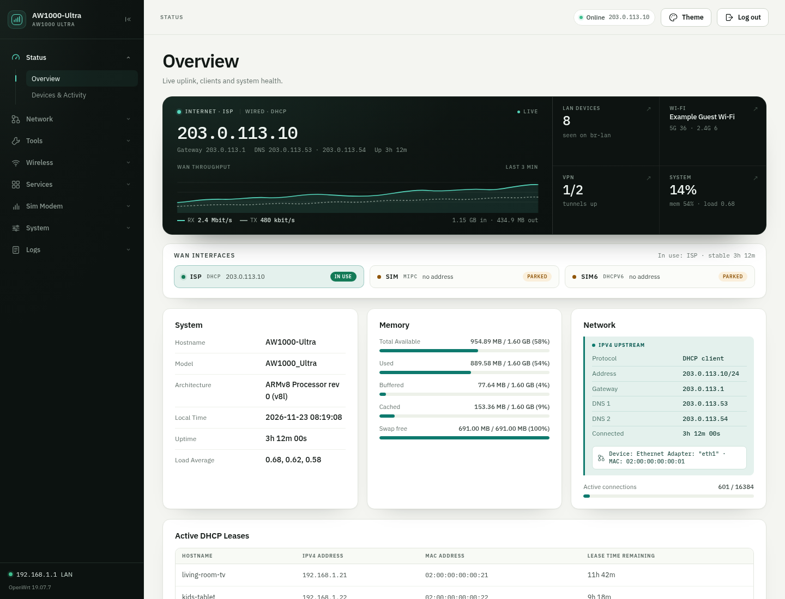
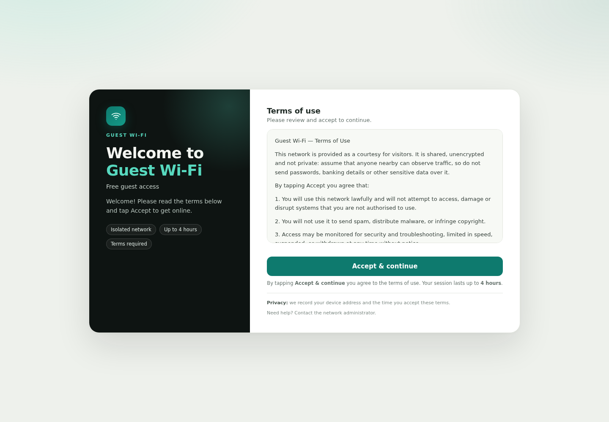
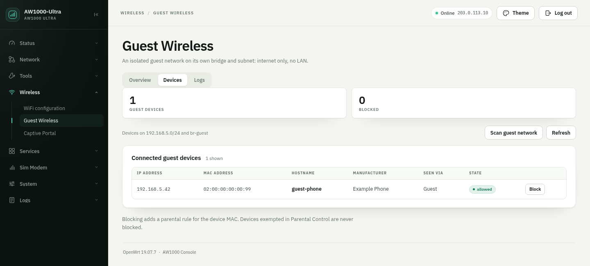
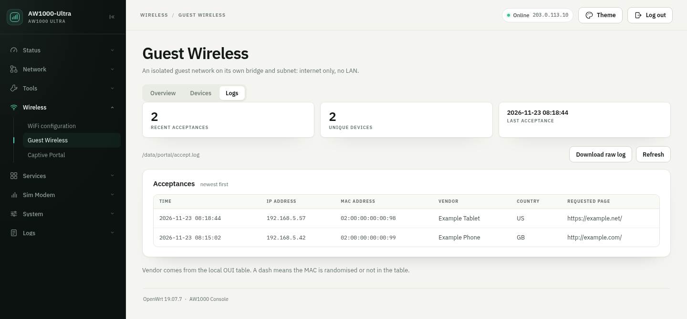
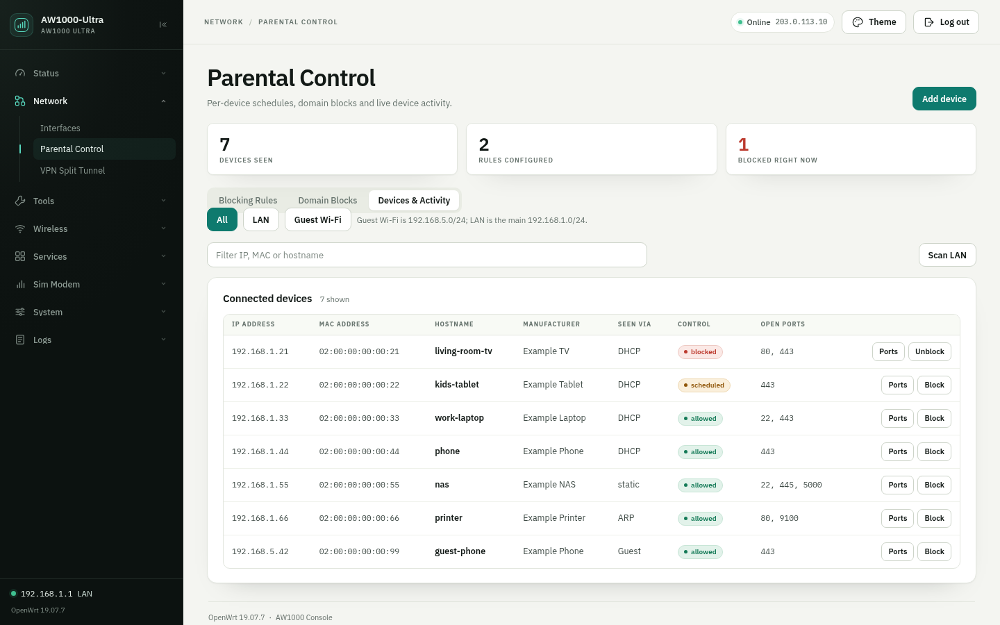
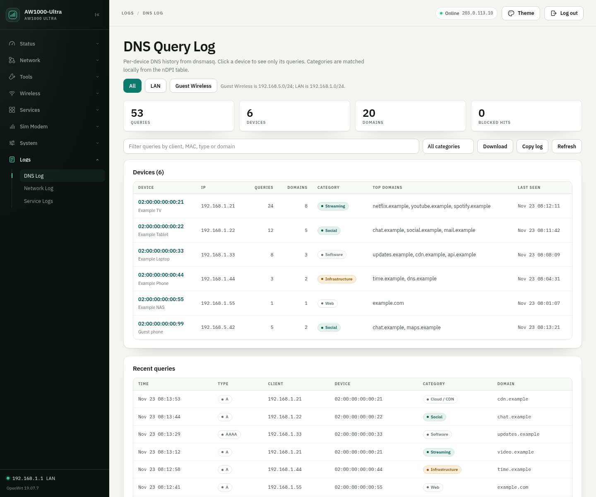
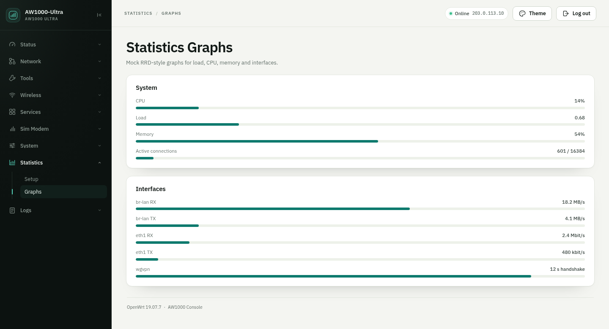
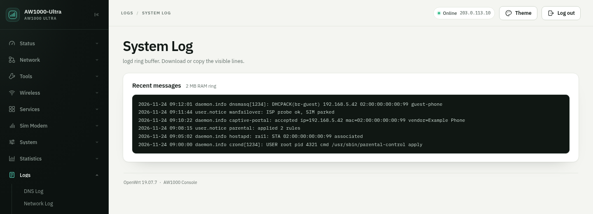
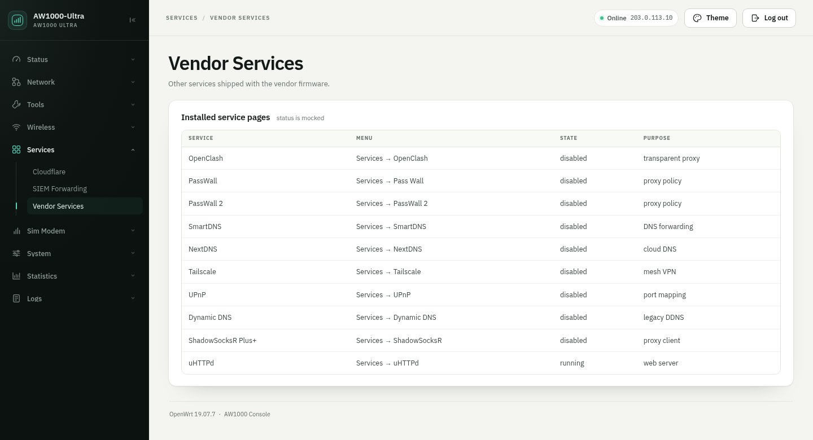
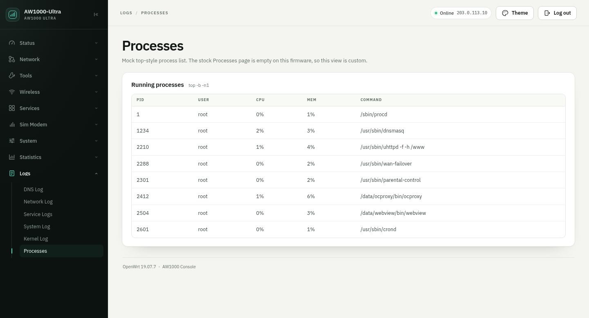

# AW1000Ultra-OpenWRT

A practical customisation for the **AW1000_Ultra 5G CPE** running the vendor
MediaTek OpenWrt 19.07.7 firmware: a cleaner LuCI console, guest Wi-Fi with a
captive portal, parental controls, DNS and service logs, ISP/5G failover, and
optional Cloudflare, SIEM and on-router tools.

[](https://disclosurez.github.io/AW1000Ultra-OpenWRT/)
[](docs/INSTALL.md)
[](AGENTS.md)
[](LICENSE)

> **This is not a firmware image.** It is an overlay of theme files, LuCI
> pages, services and sanitised configuration seeds that the installer copies
> to a router you already have running the supported firmware.

> **Unofficial project.** Not affiliated with ZTE, MediaTek, OpenWrt or any
> carrier. It targets the vendor firmware with the MediaTek Wi-Fi stack, not
> upstream OpenWrt. Read the scripts before running them. Installing on a
> different model or firmware can brick the device. Use at your own risk.

> **Try it first:** [open the interactive demo](https://disclosurez.github.io/AW1000Ultra-OpenWRT/).
> It uses fictional data and never contacts a router.

---

## What you get

- **A calmer console.** A graphite-and-bone LuCI theme with a live Overview,
  WAN-interface strip, mobile drawer and matching login page.
- **Guest Wi-Fi that is actually separate.** Tick **Guest network** on an SSID
  and it moves to `br-guest` (`192.168.5.0/24`) with its own DHCP and firewall
  zone: internet only, no LAN.
- **A one-tap captive portal.** Terms page, session length and an acceptance
  log with IP, MAC and vendor. **Wireless → Guest Wireless** has
  **Overview / Devices / Logs** tabs; block or unblock guests and review who
  accepted.
- **Parental controls.** Per-device ban/schedule rules, domain blocks, usage
  samples, open-port scans, and **All / LAN / Guest Wi-Fi** device scopes.
- **Logs you can read.** DNS history with categories and per-device
  drill-down, network/service/system logs, and optional SIEM forwarding.
- **Two uplinks, no drama.** Wired ISP is primary; the 5G SIM stays parked as
  standby and takes over automatically if the ISP fails.
- **Optional extras.** VPN split tunnel, Cloudflare DDNS/tunnels, LED control,
  SMB file shares and router storage, an OpenCode client, and a web viewer.

The long-form operating reference — commands, firewall details, verification
drills and changelog — is [`AGENTS.md`](AGENTS.md). Read it before changing
network or firewall settings.

---

## Before you start

| | |
|---|---|
| **Device** | AW1000_Ultra 5G CPE (MediaTek mt6890, aarch64) |
| **Firmware** | Vendor `5G_modem_Gen2`, OpenWrt 19.07.7, kernel 4.19.190 |
| **LuCI** | Legacy Lua controllers (not OpenWrt 21.02+ JavaScript LuCI) |
| **Wi-Fi** | Vendor MediaTek `mt_wifi` / `wapp` stack, not mac80211 |
| **Access** | SSH as `root`; key auth preferred, password auth works with `sshpass` |
| **Workstation** | `git`, `tar`, `ssh`; `sshpass` only for password auth |
| **Router space** | About 1 MB of overlay for scripts/pages; large data belongs on `/data` |

Most required packages are already on the vendor image. If a service refuses to
start, check that `ipset`, `conntrack`, `ebtables`, the `iptables-mod-*`
modules, `curl` and `gzip` are installed. The full required and optional list
is in [`install/packages.txt`](install/packages.txt).

**This only supports the device and firmware above.** If you are on a
different model or LuCI generation, treat the repository as a reference, not a
drop-in install.

**Back up first.** Keep a working way back in — another LAN device, a serial
console, or a known-good config backup.

---

## Install

### 1. Back up the router configuration

```sh
ssh root@192.168.0.1 'B=/root/config-backup-$(date +%s); mkdir -p "$B"; cp -a /etc/config "$B"/'
```

### 2. Clone the repository

```sh
git clone https://github.com/disclosurez/AW1000Ultra-OpenWRT.git
cd AW1000Ultra-OpenWRT
```

### 3. Run the installer

With SSH keys (recommended):

```sh
ROUTER=root@192.168.0.1 ./install/install.sh
```

With a password, without writing it into the repository:

```sh
SSHPASS='your-router-password' ROUTER=root@192.168.0.1 ./install/install.sh
```

The installer:

1. checks that the router is reachable over SSH;
2. uploads the payload to `/tmp/aw1000-install`;
3. backs up `/etc/config` to `/root/aw1000-backup-<epoch>/`;
4. installs the selected components, registers firewall includes, merges cron
   entries and enables services;
5. reloads the firewall, dnsmasq, LuCI and the captive portal.

It is safe to run again. It **does not overwrite existing `/etc/config/*`
files**; seeds from `uci/` are written only when the matching config file is
absent.

### 4. Open LuCI

Browse to **http://192.168.0.1** and log in. The console theme should load.
If you see the stock Bootstrap theme, open **System → Theme** and select
**AW1000 Console**.

### Optional: install only some parts

Everything is enabled by default except the stock-theme patches. Disable a
component with its switch, for example:

```sh
WITH_OPENCODE=0 WITH_WEBVIEW=0 WITH_FILESHARES=0 \
ROUTER=root@192.168.0.1 ./install/install.sh
```

<details>
<summary>All component switches</summary>

| Variable | Component |
|---|---|
| `WITH_THEME` | Console theme, menu and login page |
| `WITH_PARENTAL` | Parental control and device activity |
| `WITH_LOGS` | Logs menu, DNS log, categories and scopes |
| `WITH_WANFAILOVER` | ISP/5G uplink watchdog |
| `WITH_VPNSPLIT` | WireGuard split tunnel |
| `WITH_CAPTIVEPORTAL` | Splash server, portal pages and guest enforcement |
| `WITH_CLOUDFLARE` | DDNS updater and tunnel connector |
| `WITH_SIEM` | SIEM log forwarding |
| `WITH_LEDS` | Uplink-state LED controller |
| `WITH_OPENCODE` | OpenCode proxy and UI |
| `WITH_WEBVIEW` | Web viewer and HTTPS bridge |
| `WITH_FILESHARES` | SMB browser and router drop box |
| `WITH_VENDOR_PATCHES` | Patched Wi-Fi pages, guest checkbox, Physical Interfaces tab |
| `WITH_BOOTSTRAP_PATCHES` | Optional stock-theme fixes (default `0`) |
| `ACTIVATE_THEME` | Point LuCI at the console theme |

</details>

The OpenCode proxy, HTTPS gate and web viewer are static Go binaries and are
not shipped in the repository. Build them with `./build-ocproxy.sh`,
`./build-ocgate.sh`, `./build-webview.sh` and `./build-wvcgi.sh`; see
[`docs/INSTALL.md`](docs/INSTALL.md) for deployment.

---

## First-run checklist

1. **Check the console.**
   Open **Overview**. The hero should show the active uplink, and the
   **WAN interfaces** strip should list ISP, SIM and SIM6. If LuCI is blank or
   returns a 500, stop and use [Troubleshooting](#troubleshooting).

2. **Set up Wi-Fi.**
   Open **Wireless → WiFi configuration**. Set the main SSID and password.
   Tick **Guest network** on any SSID that should be isolated on `br-guest`
   (`192.168.5.0/24`). Save and apply.

3. **Turn on the guest network and portal.**
   Open **Wireless → Guest Wireless → Overview**. Enable the guest network and
   the captive portal, then **Save & apply**. This points the portal at
   `br-guest`, not the main LAN.
   Keep `gate_iface = br-guest`; selecting `br-lan` also gates wired LAN clients.

4. **Test the guest flow.**
   Join the guest SSID from a phone. The terms page should appear. Tap
   **Accept & continue** — there is no separate checkbox — and the success
   page should open the internet.
   Check **Wireless → Guest Wireless → Devices** for the client and
   **Logs** for IP, MAC, vendor and requested page.

5. **Set parental rules.**
   Open **Network → Parental Control**. Add device rules, schedules and domain
   blocks. **Devices & Activity** has **All / LAN / Guest Wi-Fi** scopes; the
   same page is also available from **Status → Devices & Activity**.

6. **Check the uplinks.**
   On **Overview**, confirm the ISP is **In use** and the SIM is **Parked**.
   The SIM wakes automatically after repeated ISP probe failures. Do not change
   network or firewall zones without a recovery path.

7. **Try the logs.**
   **Logs → DNS Log** shows per-device DNS history and categories.
   **Logs → Network Log** filters interface/DHCP/Wi-Fi/firewall/VPN events.
   **Logs → Service Logs** has one page per service.

8. **Add optional services last.**
   **Services → Cloudflare**, **Services → SIEM Forwarding**,
   **System → LED Configuration** and **System → Theme** are safe to configure
   after the basics work. **Tools → Web Viewer / File Shares / OpenCode** need
   their optional binaries.

---

## Where to find things

| Page | What it does |
|---|---|
| **Overview** | Live uplink, WAN interfaces, clients, Wi-Fi, VPN and health |
| **Network → Interfaces** | Interfaces and the **Physical Interfaces** tab |
| **Network → Parental Control** | Rules, domain blocks, devices and activity |
| **Network → VPN Split Tunnel** | Domains/IPs routed through WireGuard |
| **Wireless → WiFi configuration** | SSIDs, radios and the **Guest network** checkbox |
| **Wireless → Guest Wireless** | Overview, Devices, Logs; portal toggle |
| **Wireless → Captive Portal** | Splash text, gated interface, session length, exemptions |
| **Services → Cloudflare** | DDNS and tunnel connectors |
| **Services → SIEM Forwarding** | Syslog or HTTPS log delivery |
| **System → LED Configuration** | Uplink-state LEDs and test state |
| **System → Theme** | Console or stock Bootstrap |
| **Tools** | Web Viewer, File Shares, OpenCode |
| **Logs** | DNS, Network, Service, System and Kernel logs |

---

## Screenshots

All images use fictional or example data. See
[`docs/screenshots/`](docs/screenshots/) for the full set.

| | |
|---|---|
|  |  |
|  |  |
|  |  |
|  |  |
|  |  |

---

## Everyday use

- **Guest access:** **Wireless → Guest Wireless** toggles the guest network and
  portal. **Devices** blocks/unblocks; **Logs** shows acceptances.
- **Parental control:** **Network → Parental Control** for rules and domain
  blocks; **Status → Devices & Activity** for the quick device view.
- **Logs:** **Logs → DNS Log** for per-device history, **Service Logs** for
  procd/daemon output. The system log is a 2 MB RAM ring buffer.
- **Update:** use a fresh checkout of the latest version and re-run the
  installer. Back up first; the installer still will not overwrite existing
  config files.
- **Theme:** flip between **AW1000 Console** and stock Bootstrap in
  **System → Theme**, or use the topbar *Theme* button.
- **Rollback:** restore `/root/aw1000-backup-<epoch>/` and run
  `reload_config`; disable a service with `/etc/init.d/<name> disable`.

---

## Troubleshooting

| Problem | What to check |
|---|---|
| **Cannot reach LuCI after install** | SSH from another LAN device. Check `uhttpd` and the firewall. If needed, reboot or restore the `/root/aw1000-backup-*` config. |
| **LuCI returns 500 after an edit** | The traceback is in the page and `logread`. Revert the last file, then `rm -rf /tmp/luci-modulecache` and `/etc/init.d/uhttpd restart`. |
| **Guest cannot see the portal** | **Wireless → Guest Wireless → Overview**: is `br-guest` up, is the portal running, and is the gated interface `br-guest`? Check the `wifi_guest` firewall zone. |
| **Portal keeps coming back** | Check `/data/portal/accept.log` and `/usr/sbin/captiveportal status`. Confirm the session length and the `portal_ok`/`portal_ok_ip` sets. |
| **SIM does not take over** | Check `/tmp/wanfailover.status`, `ip route show default` and `logread -e wanfailover`. The full test drill is in [`AGENTS.md`](AGENTS.md). |
| **LED page looks wrong** | Run `/usr/sbin/aw1000-led status`; confirm the controller is enabled. Disabling it hands the LEDs back to the vendor daemon. |
| **Menu is stale after adding a page** | Log out and back in, or open a new tab. The vendor LuCI caches the menu in `sessionStorage`. |

More recovery commands and known pitfalls are in
[`AGENTS.md`](AGENTS.md) and [`docs/INSTALL.md`](docs/INSTALL.md).

---

## Security and privacy

- **No live credentials or client data are committed.** Config seeds,
  screenshots and examples use placeholders and documentation ranges.
- **Tokens stay in `0600` files.** Cloudflare, SIEM and SMB credentials are
  read from files or temporary auth files, never passed in `argv`.
- **Review before you run.** The installer runs as `root` and changes firewall
  and service state.
- **Redact before sharing.** Logs can contain client IPs, MACs, hostnames and
  domains. Remove them before posting publicly.

---

## Documentation

- [`docs/INSTALL.md`](docs/INSTALL.md) — full workstation-to-router walkthrough.
- [`AGENTS.md`](AGENTS.md) — operating reference, firewall details, test drills
  and changelog.
- [`docs/demo/`](docs/demo/) — static interactive demo covering the custom pages and the stock LuCI/vendor menu pages.
- [`install/packages.txt`](install/packages.txt) — package requirements.
- [`docs/screenshots/`](docs/screenshots/) — current UI screenshots.

## Contributing

Issues and pull requests are welcome. Never commit credentials, client data or
live identifiers. Test changes on the supported hardware, keep the installer
idempotent, and update the docs or screenshots when the UI changes.

## License

Released under the **MIT License**. See [`LICENSE`](LICENSE). Third-party
components keep their own licenses; the repository does not redistribute vendor
firmware or the Cloudflare binaries.

## Disclaimer

This project is provided **as is**, without warranty. It changes firewall
rules, network interfaces and system services on a device that may be your only
uplink. Back up the device, keep a recovery path, and test before relying on
it. The authors are not responsible for outages, data loss, bricked devices or
regulatory non-compliance.
